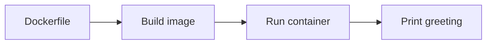

# Docker greeting

A minimal Alpine container that prints `Hello from Docker!`.





## Run locally

```bash
docker build -t jenkins-docker-test .
docker run --rm jenkins-docker-test
```

| File | Purpose |
| --- | --- |
| [Dockerfile](Dockerfile) | Alpine base image and echo command. |
| [README.me](README.me) | Original repository note. |

No Jenkinsfile is checked in; Jenkins job configuration is separate from this image.
